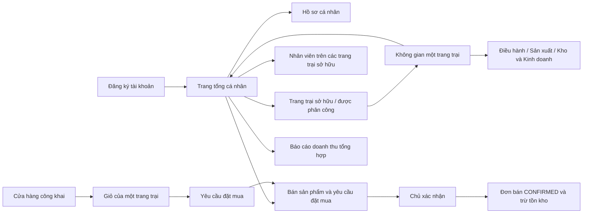

# Trang tài khoản và cửa hàng nông sản

## Luồng sử dụng

Đăng ký mới chỉ cần họ tên, tên đăng nhập, email và mật khẩu. Giao diện tự đăng nhập vào trang tổng; không bắt tạo trang trại hoặc nhân viên. Chủ có thể tạo nhiều trang trại và vào làm việc ngay. Nhân viên dùng tài khoản chủ cấp, chỉ thấy các trang trại được phân công; tổng hợp doanh thu và nhân viên chỉ gồm trang trại mình là chủ.

Menu tài khoản gồm Tổng quan, Trang trại của tôi, Đội ngũ nhân viên, Bán sản phẩm, Báo cáo doanh thu và Hồ sơ cá nhân. Khi vào một trang trại, menu đổi theo ngữ cảnh và quyền được cấp. Nút **Về trang tổng** kết thúc ngữ cảnh trang trại. Trên điện thoại, dùng nút menu góc trên trái.

## Bán nông sản

1. Vào trang trại, cấu hình mùa vụ và ghi nhận thu hoạch để có lô nông sản thực tế.
2. Về trang tổng → Bán sản phẩm → Sản phẩm đăng bán → Thiết lập. Nhập tên công khai, mô tả, giá theo đơn vị của lô, bật Công khai trên cửa hàng.
3. Khách mở `/shop/`, tìm nông sản, thêm vào giỏ của **một** trang trại và gửi thông tin nhận hàng. Không cần tài khoản. Chưa thanh toán trực tuyến, phí giao hàng do trang trại xác nhận sau.
4. Yêu cầu ở trạng thái PENDING, chưa giữ hay trừ kho. Khách lưu đường dẫn ngẫu nhiên để tra trạng thái. Người có đường dẫn xem được sản phẩm, số lượng, giá và trạng thái; không xem được thông tin liên hệ/giao hàng của khách.
5. Chủ vào trang tổng → Bán sản phẩm → Đơn đặt mua → Xem đơn. Xác nhận tạo đơn bán CONFIRMED, khách hàng riêng cho đơn và trừ tồn kho trong cùng giao dịch. Không đủ hàng thì toàn bộ giao dịch rollback. Từ chối không thay đổi tồn kho.
6. Quản lý giao hàng, thanh toán hoặc hủy đơn trong **Đơn bán hàng** của trang trại. Hủy đơn đã trừ kho hoàn tồn bằng nghiệp vụ hiện có. Doanh thu tổng hợp chỉ tính đơn DELIVERED, theo ngày lập đơn, không suy diễn lợi nhuận hay tiền thực thu.

## Dữ liệu và vận hành

Migration V018 thêm hồ sơ, sản phẩm đăng bán, yêu cầu đặt mua và chi tiết. Giữ các migration V001–V017 nguyên trạng. Chuyển trang trại cũ đang ở bước STAFF sang READY để chủ vào quản lý mà không bắt buộc tạo nhân viên. Không thay đổi chủ sở hữu, quyền hoặc dữ liệu nghiệp vụ cũ.

Các API `/api/v1/account/**` luôn bỏ qua X-Farm-Id từ trình duyệt. Máy chủ kiểm tra quyền OWNER trước khi chuyển ngữ cảnh từng trang trại; vẫn dùng RLS PostgreSQL. Cửa hàng chỉ đọc dữ liệu hàng được chủ công khai qua các hàm có giới hạn trường. Đặt mua và duyệt đơn có khóa giao dịch, kiểm tra tồn kho và chống gửi lặp. Thay đổi giá có version, giỏ giá cũ bị từ chối để khách kiểm tra lại.

Hiện bản cài Windows vẫn dùng **https://localhost:8443/** và cửa hàng **https://localhost:8443/shop/**, chỉ nghe 127.0.0.1 theo lựa chọn người dùng. Công khai ở đây là quyền khách xem/đặt không đăng nhập; chưa có máy ngoài truy cập qua Internet hoặc LAN. Cần phương án triển khai mạng riêng nếu muốn mở cho khách bên ngoài thực sự; không đổi Public/Private hay firewall tự động trong lần cập nhật giao diện này.

Mỗi trang trại: trang bán hiển thị 100 đơn gần nhất và 200 lô gần nhất. Danh mục công khai tối đa 1.000 sản phẩm. Không tích hợp cổng thanh toán, đơn vị vận chuyển hoặc email/SMS thông báo tự động.

## Tham khảo bố cục

Dùng phân cấp tài khoản → ngữ cảnh làm việc và điều hướng dọc theo nhóm chức năng, tham khảo [Carbon UI shell](https://carbondesignsystem.com/components/UI-shell-left-panel/usage/) và [Atlassian app/organization switcher](https://support.atlassian.com/platform-experiences/docs/how-to-switch-between-apps-and-organizations/). Giao diện được viết trong dự án hiện có, dùng dữ liệu máy chủ thực tế.

## Chạy bằng file Application trong IntelliJ

Run `FarmManagementSystemN02Application.java` trực tiếp. Cấu hình duy nhất là
`application.properties`, nhận database/JWT/HTTPS từ biến môi trường. Trên máy này,
thoát và mở lại IntelliJ sau lần chuyển biến Windows User; web vẫn ở HTTPS 8443,
database vẫn ở 55433. Xem [ENVIRONMENT](ENVIRONMENT.md). Stop của IntelliJ tắt web.
Thông tin đăng nhập vẫn phải được API xác thực.
